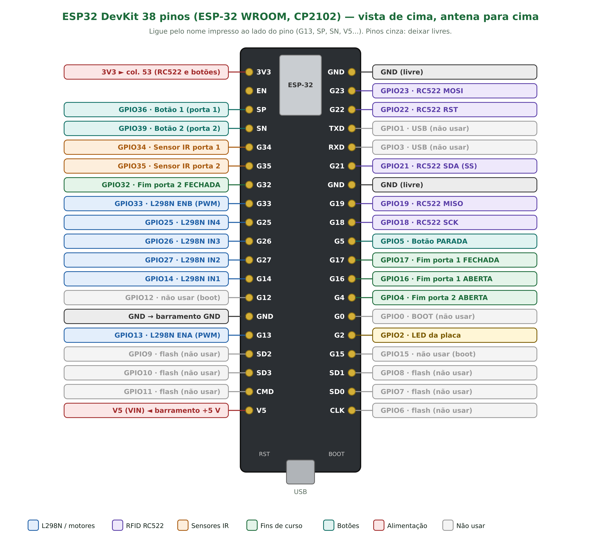
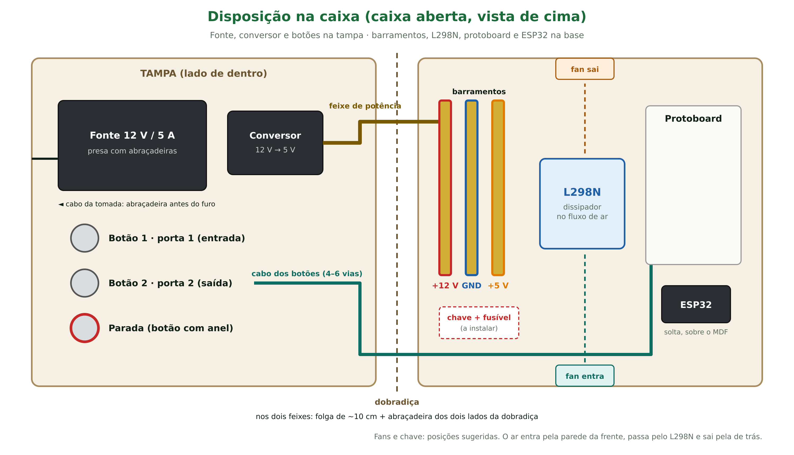
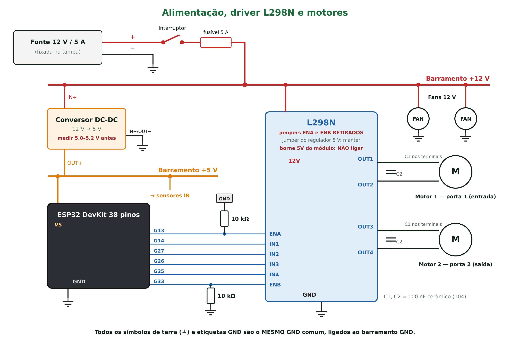
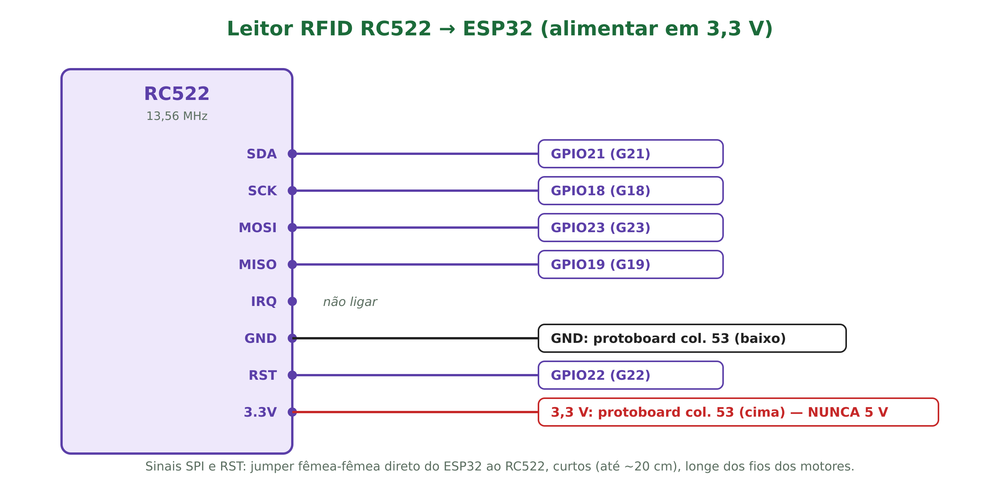
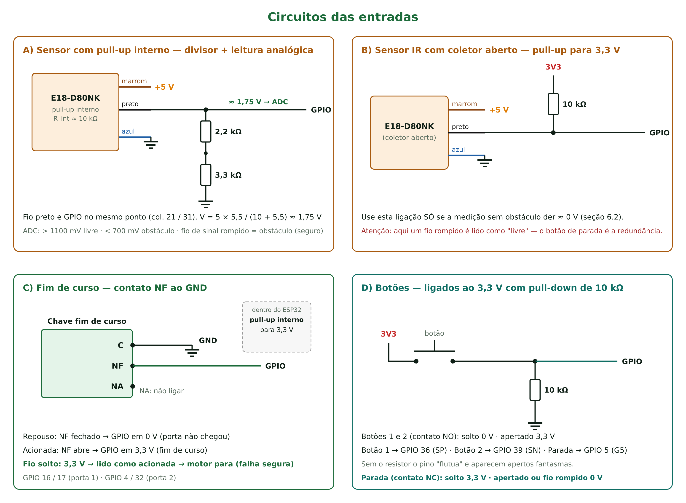
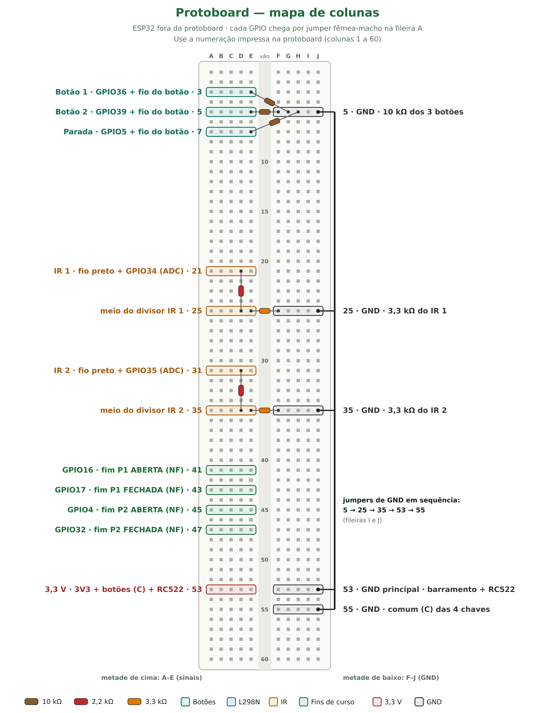

# BoviCare — Ligações elétricas do brete automatizado

Mapa de pinos e ligações **fio a fio** de toda a automação da maquete. Este documento é a **referência única da montagem**: os pinos vêm de `BoviCare_Brete/config_pinos.h` (firmware 1.0.3), e a disposição física corresponde à caixa montada.

> **Revisão 1.1 (15/10/2026) — montagem real na caixa.** Placa: **ESP32 DevKit de 38 pinos** (nomes impressos G13, SP, SN, V5…). Mudanças em relação à 1.0: alimentação por **três barramentos** (+12 V, GND, +5 V) no lugar dos trilhos da protoboard; **conversor DC-DC 12 → 5 V** no lugar do step-down ajustável; **fonte, conversor e botões na tampa**; **ESP32 fora da protoboard**, ligada por jumpers; protoboard **sem trilhos laterais**, com **mapa de colunas** fixo (seção 11); **fans 12 V**; **botões metálicos** (botões 1 e 2 no contato NO; **parada no contato NC**, falha segura — firmware 1.0.1); **sensores IR lidos pelo ADC** (firmware 1.0.2); LED de 12 V da parada no +12 V; GND da ESP32 direto no barramento; lista de fios renumerada (F01–F67).

> **Regra de ouro:** faça todas as ligações com a fonte **fora da tomada** e o USB desconectado. Energize só nas etapas de teste (seção 14).

---

## 1. Visão geral

```
 Tomada ─► Fonte 12 V/5 A ─(+)─► Chave ─► Fusível 5 A ─► BARRAMENTO +12 V ─┬─► L298N ─► Motor 1 e Motor 2
                         └(−)──────────────────────────► BARRAMENTO GND     ├─► Fans 12 V (2×)
                                                                           └─► Conversor DC-DC 12 → 5 V
                                                                                     │
                                                                          BARRAMENTO +5 V ─┬─► ESP32 (V5)
                                                                                           └─► Sensores IR (2×)
   ESP32 3V3 ─► protoboard col. 53 ─► RC522 e botões
   ESP32 GPIOs ─► protoboard (resistores) ─► botões, sensores, fins de curso, ENA/ENB
   ESP32 GPIOs ─► direto (jumper fêmea-fêmea) ─► L298N IN1–IN4 e RC522 (SPI)
```

Três níveis de tensão convivem no circuito, todos com o **mesmo GND** (barramento GND):

| Tensão | De onde vem | Quem usa |
|---|---|---|
| **12 V** | Fonte chaveada 12 V / 5 A → barramento +12 V | L298N → motores JGB37-3530 · 2 fans |
| **5 V** | Conversor DC-DC 12 → 5 V → barramento +5 V | ESP32 (pino V5/VIN) e os dois sensores IR |
| **3,3 V** | Regulador da própria ESP32 (pino 3V3) → protoboard col. 53 | RC522 e botões |

> **Os pinos do ESP32 trabalham em 3,3 V e não toleram 5 V.** Nada do barramento +5 V vai num GPIO; o sinal dos sensores IR passa por divisor de tensão. O 3,3 V **nunca** vai para os barramentos.

---

## 2. Mapa de pinos do ESP32 (tabela mestre)

Porta 1 = porta de **entrada** · Porta 2 = porta de **saída** (onde fica o leitor RFID). A coluna "Chega por" diz se o fio vai **direto** (jumper fêmea-fêmea) ou passa por uma **coluna da protoboard** (seção 11).

| GPIO | Serigrafia | Função | Direção | Liga em | Chega por |
|---|---|---|---|---|---|
| **13** | G13 | PWM do motor 1 | Saída | L298N **ENA** (+10 kΩ ao GND) | Direto (10 kΩ soldado no fio) |
| **14** | G14 | Sentido motor 1 | Saída | L298N **IN1** | Direto |
| **27** | G27 | Sentido motor 1 | Saída | L298N **IN2** | Direto |
| **26** | G26 | Sentido motor 2 | Saída | L298N **IN3** | Direto |
| **25** | G25 | Sentido motor 2 | Saída | L298N **IN4** | Direto |
| **33** | G33 | PWM do motor 2 | Saída | L298N **ENB** (+10 kΩ ao GND) | Direto (10 kΩ soldado no fio) |
| **21** | G21 | SPI SS | Saída | RC522 **SDA** | Direto |
| **18** | G18 | SPI SCK | Saída | RC522 **SCK** | Direto |
| **23** | G23 | SPI MOSI | Saída | RC522 **MOSI** | Direto |
| **19** | G19 | SPI MISO | Entrada | RC522 **MISO** | Direto |
| **22** | G22 | Reset do leitor | Saída | RC522 **RST** | Direto |
| **34** | G34 | Sensor IR porta 1 | Entrada | Fio preto do IR 1 + divisor ao GND | Protoboard col. 21 |
| **35** | G35 | Sensor IR porta 2 | Entrada | Fio preto do IR 2 + divisor ao GND | Protoboard col. 31 |
| **16** | G16 | Fim de curso porta 1 **ABERTA** | Entrada | NF da chave | Protoboard col. 41 |
| **17** | G17 | Fim de curso porta 1 **FECHADA** | Entrada | NF da chave | Protoboard col. 43 |
| **4** | G4 | Fim de curso porta 2 **ABERTA** (firmware 1.5.0+; esteve no G12 em teste) | Entrada | NF da chave | — |
| **32** | G32 | Fim de curso porta 2 **FECHADA** | Entrada | NF da chave | Protoboard col. 47 |
| **36** | SP | Botão 1 — alterna a porta 1 | Entrada | NO do botão 1 (+10 kΩ ao GND) | Protoboard col. 3 |
| **39** | SN | Botão 2 — alterna a porta 2 | Entrada | NO do botão 2 (+10 kΩ ao GND) | Protoboard col. 5 |
| **5** | G5 | Botão de **parada manual** | Entrada | **NC** do botão de parada (+10 kΩ ao GND) | Protoboard col. 7 |
| **2** | G2 | LED de estado | Saída | LED da própria placa (se houver) | Nada a ligar |
| — | V5 | Alimentação 5 V (VIN) | — | Barramento **+5 V** | Fio direto |
| — | GND | Terra | — | Barramento **GND** | Fio direto |
| — | 3V3 | Saída 3,3 V | — | Protoboard col. 53 (cima) | Protoboard |



> **Placa usada: ESP32 DevKit de 38 pinos** (módulo ESP-32 WROOM, USB com CP2102). Ligue sempre pelo **nome impresso** ao lado do pino, não pela posição: **G13** = GPIO 13, **SP** = GPIO 36, **SN** = GPIO 39, **V5** = entrada de 5 V (VIN). Em outra placa (a DevKit v1 de 30 pinos, por exemplo) os números de GPIO são os mesmos; só mudam a posição e os nomes impressos (D13, VP, VN, VIN, RX2/TX2).

> **G16 e G17** só ficam livres no módulo **WROOM** (o desta placa, sem PSRAM). Numa placa com módulo **WROVER**, eles são usados pela PSRAM: troque os fins de curso da porta 1 para outros pinos livres e altere `config_pinos.h`.

> **Pinos SD0, SD1, SD2, SD3, CMD e CLK** (GPIO 6 a 11) ligam a memória flash: **nunca use**. **G0**, **G2**, **G12** e **G15** são pinos de boot; o G2 só aciona o LED da placa.

### Pinos que NÃO podem ser usados

| GPIO | Motivo |
|---|---|
| 6 a 11 | Ligados à memória flash interna — usar trava a placa |
| 0 | Botão BOOT; nível baixo no boot entra em modo de gravação |
| 1 e 3 | Serial USB (monitor serial e gravação) |
| 12 | Se estiver em nível alto no boot, a placa não liga corretamente |
| 15 | Pino de configuração do boot |

---

## 3. Montagem na caixa

A caixa de MDF tem duas metades unidas pela dobradiça:

| Metade | O que fica nela |
|---|---|
| **Tampa** (lado de dentro) | Fonte 12 V (presa com abraçadeiras) · conversor DC-DC · 3 botões metálicos (furados na tampa, acessíveis por fora) |
| **Base** | 3 barramentos na parede da dobradiça · L298N · protoboard · ESP32 · fans nas paredes · chave e fusível |



Regras de montagem:

- **Dobradiça:** dois feixes cruzam a dobradiça — o de **potência** (fonte e conversor → barramentos) e o **cabo dos botões** (4 a 6 vias → protoboard). Em cada feixe deixe **~10 cm de folga**, passe os fios ao longo do eixo da dobradiça e prenda com **abraçadeira dos dois lados**. Assim o fio torce um pouco em vez de dobrar sempre no mesmo ponto.
- **Barramentos:** suportes isolantes, pelo menos 3 cm entre barras. Os suportes de +12 V e +5 V são da **mesma cor**: etiquete as três barras (**+12 V**, **GND**, **+5 V**).
- **Fios nas barras:** o parafuso da barra foi feito para fio grosso. Use **terminal tubular** (ilhós) em cada fio ou dobre a ponta descascada ao meio antes de apertar. Puxe cada fio para conferir.
- **ESP32:** fica **fora da protoboard**, deitada no MDF ao lado dela, presa com fita dupla-face ou abraçadeira frouxa, **longe** dos barramentos, do dissipador do L298N e de parafusos. Não cubra com metal a ponta da antena (lado oposto ao USB). Deixe o USB acessível.
- **Cabo da tomada:** abraçadeira apertada no cabo **por dentro**, logo antes do furo de saída, para o puxão não chegar na fonte.
- **Fans:** uma **entrando** e outra **saindo**, em paredes opostas, com o L298N no caminho do ar. A seta na lateral da fan mostra o sentido do ar.
- **Botões:** etiquete por fora — "Porta 1 – Entrada", "Porta 2 – Saída" e "Parada".

---

## 4. Alimentação

### 4.1 Componentes

- Fonte chaveada **12 V / 5 A** (HZS SU-168: entrada 100–240 V CA, saída 12 V CC / 5 A)
- **Chave** liga/desliga (mínimo 6 A) e **porta-fusível com fusível 5 A**
- **Conversor DC-DC 12 → 5 V** (Utronix, encapsulado)
- **3 barramentos** de latão com suportes isolantes: **+12 V**, **GND** e **+5 V**
- **2 fans 12 V** (confirmar na etiqueta tensão e corrente)

### 4.2 Ligações dos barramentos

| Barramento | Recebe (um parafuso para cada fio) |
|---|---|
| **+12 V** | Fonte (+), pela chave e pelo fusível · entrada + do conversor · L298N **12V** · fan 1 e fan 2 (vermelho) |
| **GND** | Fonte (−) · entrada − e saída − do conversor · L298N **GND** · **GND da ESP32** · protoboard col. 53 (baixo) · azul dos sensores IR · fan 1 e fan 2 (preto) |
| **+5 V** | Saída + do conversor · ESP32 **V5** (VIN) · marrom dos sensores IR |

**Não ligue nos barramentos:** o 3,3 V da ESP32, o borne **5V** do L298N (é uma saída) e nenhum GPIO.

### 4.3 Passo a passo

1. Com a fonte na tomada e nada mais ligado, **meça a saída** e identifique o + e o − (ponta vermelha no +, deve marcar **+12 V**). Marque o + com fita vermelha. Se a fonte mantiver o plugue P4, use um conector P4 fêmea com borne; se o plugue foi cortado, ligue os fios direto.
2. Fonte (+) → **chave** → **fusível 5 A** → barramento **+12 V**.
3. Fonte (−) → barramento **GND**.
4. Conversor: entrada + → **+12 V**; entrada − → **GND**; saída − → **GND**. Confira na etiqueta qual par é entrada e qual é saída.
5. **Antes** de ligar a saída + do conversor na barra **+5 V**, meça a ponta solta contra o GND: **5,0 a 5,2 V**. Se aparecer 12 V, o fio não é a saída. Enquanto estiver solta, mantenha a ponta isolada com fita.
6. Saída + do conversor → barramento **+5 V**.
7. Fans: vermelho → **+12 V**, preto → **GND**. Fio amarelo/azul (sensor de rotação ou PWM): isolar a ponta e não ligar; a fan gira na rotação máxima.

### 4.4 Consumo (fonte de 5 A)

| Carga | Corrente em 12 V |
|---|---|
| 2 motores rodando | ~0,3 a 0,5 A cada |
| 2 motores travados (pior caso) | ~2,4 A no total |
| ESP32 + RC522 + sensores (pelo conversor) | ~0,15 A |
| 2 fans | ver etiqueta (comum: 0,1 a 0,3 A cada) |

No pior caso sobram cerca de 2,4 A para as fans. Ligar motores e fans na mesma fonte não reduz a eficiência: todos recebem os mesmos 12 V em paralelo.

### 4.5 Bitola sugerida

| Trecho | Corrente máxima | Fio |
|---|---|---|
| Fonte → chave → fusível → barramento +12 V → L298N → motores | até 2,4 A | 0,5 mm² (≈ 20 AWG) ou mais grosso |
| Fans, conversor, 5 V, 3,3 V e sinais | < 0,5 A | Jumper ou fio de 0,2–0,3 mm² |

---

## 5. Driver L298N e motores

### 5.1 Preparação do módulo

| Item do módulo | O que fazer | Por quê |
|---|---|---|
| Jumper **ENA** | **Retirar** | O ESP32 controla a velocidade por PWM nesse pino |
| Jumper **ENB** | **Retirar** | Idem para o motor 2 |
| Jumper do regulador 5 V ("5V-EN"/"12V") | **Manter** | Com 12 V na entrada, o regulador interno alimenta a lógica do L298N |
| Borne **5V** do L298N | **Não ligar em nada** | É uma *saída* do regulador interno |

Posicione o L298N **no caminho do ar** entre as fans, com o dissipador de pé.

### 5.2 Ligações

| Borne / pino do L298N | Liga em | Como |
|---|---|---|
| **12V** (VS) | Barramento **+12 V** | Fio 0,5 mm² |
| **GND** | Barramento **GND** | Fio 0,5 mm² |
| **OUT1** e **OUT2** | Motor 1 (porta de entrada) | Fio 0,5 mm² |
| **OUT3** e **OUT4** | Motor 2 (porta de saída) | Fio 0,5 mm² |
| **ENA** | GPIO 13, com 10 kΩ ao GND soldado no fio perto da L298N | Jumper fêmea-fêmea + emenda em Y |
| **IN1** | GPIO 14 | Jumper fêmea-fêmea direto |
| **IN2** | GPIO 27 | Jumper fêmea-fêmea direto |
| **IN3** | GPIO 26 | Jumper fêmea-fêmea direto |
| **IN4** | GPIO 25 | Jumper fêmea-fêmea direto |
| **ENB** | GPIO 33, com 10 kΩ ao GND soldado no fio perto da L298N | Jumper fêmea-fêmea + emenda em Y |

**Montagem dos resistores de ENA/ENB (adotada):** em cada fio de controle (G13 → ENA e G33 → ENB), faça uma emenda em Y a **3–5 cm da L298N** e solde um **10 kΩ** saindo dela. Una as outras pontas dos dois resistores num fio curto e prenda esse fio no **borne GND da L298N**, junto com o fio do barramento GND. Isole tudo com termorretrátil.

**Os dois resistores de 10 kΩ em ENA/ENB** mantêm os motores desligados enquanto o ESP32 reinicia (durante o boot os GPIOs ficam soltos, e o GPIO 14 chega a emitir pulsos). Também garantem o desligamento se o *watchdog* reiniciar a placa.



### 5.3 Como o firmware aciona cada motor

| Ação | INa | INb | EN | Efeito |
|---|---|---|---|---|
| **SUBIR** (abrir) | 1 | 0 | PWM (rampa 120 → 255 em 300 ms) | Enrola a corda, a porta sobe |
| **DESCER** (fechar) | 0 | 1 | PWM (rampa 120 → 255 em 300 ms) | Desenrola, a porta desce |
| **FREAR** | 0 | 0 | 100 % | Terminais em curto: freio dinâmico (150 ms) |
| **PARADO** | 0 | 0 | 0 | Motor solto |

(INa/INb = IN1/IN2 no motor 1 e IN3/IN4 no motor 2.)

### 5.4 Capacitores de supressão de ruído (100 nF cerâmico, código **104**)

Escovas de motor DC geram ruído elétrico que pode travar o RC522 e causar leituras falsas. Use os 4 capacitores assim, **2 por motor**:

- **C1:** soldado direto nos **dois terminais do motor** (o mais importante).
- **C2:** no borne do L298N, entre **OUT1 e OUT2** (motor 1) e entre **OUT3 e OUT4** (motor 2).

Capacitor cerâmico **não tem polaridade**.

### 5.5 Sentido de giro

No teste da etapa 9 (seção 14), se a porta **desenrolar** quando deveria **enrolar**:

- inverta os dois fios daquele motor no borne do L298N, **ou**
- mude `INVERTER_MOTOR_1` (ou `_2`) para `1` em `config_pinos.h` e grave de novo.

A corda deve sair do tambor de forma que, ao girar no sentido "SUBIR", ela seja recolhida.

---

## 6. Leitor RFID RC522

> **Alimente em 3,3 V. Nunca em 5 V** — o RC522 queima.

| Pino do RC522 | Liga em | Como |
|---|---|---|
| **3.3V** | Protoboard col. **53 (cima)** — 3,3 V | Jumper macho-fêmea |
| **RST** | GPIO **22** | Jumper fêmea-fêmea direto |
| **GND** | Protoboard col. **53 (baixo)** — GND principal | Jumper macho-fêmea |
| **IRQ** | Não ligar | — |
| **MISO** | GPIO **19** | Jumper fêmea-fêmea direto |
| **MOSI** | GPIO **23** | Jumper fêmea-fêmea direto |
| **SCK** | GPIO **18** | Jumper fêmea-fêmea direto |
| **SDA** | GPIO **21** | Jumper fêmea-fêmea direto |



Cuidados de montagem:

- **Fios curtos** (até ~20–30 cm) entre o RC522 e o ESP32. SPI longo e solto pega ruído. Se o leitor precisar ficar mais longe, informe a distância: a velocidade do SPI pode ser reduzida no firmware.
- **Afaste os fios do RC522 dos fios dos motores.** Se precisarem cruzar, cruze em 90°.
- **Posição:** junto à **porta de saída**, na altura da tag do animal contido. O alcance é de poucos centímetros.
- **Não fixe a antena sobre metal:** use um espaçador de MDF ou plástico de 1–2 cm.

---

## 7. Sensores de presença IR E18-D80NK

Um sensor por porta, mirando a **zona por onde a porta desce**. Ele dispara a **parada automática**: se detectar algo durante o fechamento, o firmware freia e **reabre** a porta.

### 7.1 Fios do sensor

| Cor (mais comum) | Cor (variação) | Função | Liga em |
|---|---|---|---|
| **Marrom** | Vermelho | +5 V | Barramento **+5 V** |
| **Azul** | Verde | GND | Barramento **GND** |
| **Preto** | Amarelo | Sinal (saída) | Protoboard col. **21** (IR 1) / **31** (IR 2), no mesmo ponto do GPIO 34 / 35 (seção 7.3) |

As cores variam de fabricante para fabricante. Confira na etiqueta antes de ligar. Use cabo de 3 vias por sensor e etiquete as duas pontas ("IR1", "IR2").

### 7.2 Medição obrigatória antes de ligar o sinal

Existem dois tipos de saída no mercado com o mesmo nome:

1. Ligue **só** o marrom no +5 V e o azul no GND. Deixe o fio preto **solto**.
2. Meça a tensão entre o **fio preto** e o GND, **sem nada na frente** do sensor.

| Leitura sem obstáculo | Tipo de saída | Ligação a usar |
|---|---|---|
| **≈ 5 V** | Com pull-up interno | **Variante A — divisor de tensão** (7.3) |
| **≈ 0 V**, oscilando ou "flutuando" | Coletor aberto (NPN) | **Variante B — pull-up para 3,3 V** (7.4) |

Nos dois tipos, com a mão na frente, a saída vai a **0 V** (o LED traseiro acende).

> **Faça a medição com o LED do sensor APAGADO.** Se o LED estiver aceso sem nada na frente, o sensor está enxergando a mesa, a parede ou a estrutura, e a saída fica em 0 V de qualquer jeito: a medição não vale. Aponte o sensor para um espaço livre ou gire o parafuso traseiro no sentido anti-horário até o LED apagar.

> **Resultado dos sensores do projeto (16/10/2026):** etiqueta "PHOTOELECTRIC SWITCH, 5 VDC, NPN NO, 10–80 cm". Com o LED apagado o fio preto mede **5 V**; com a mão na frente, **0 V**. Portanto os sensores têm pull-up interno (≈ 10 kΩ, ver 7.3): **use a variante A (divisor), na forma da seção 7.3**. **Nunca ligue o fio preto direto no G34/G35.**

### 7.3 Variante A — divisor de tensão + leitura analógica (ligação adotada)

O sensor do projeto tem um resistor interno (R_int ≈ **10 kΩ**) entre a saída e o +5 V. A parte de baixo do divisor é o 2,2 kΩ **em série** com o 3,3 kΩ (5,5 kΩ) até o GND. O fio preto e o GPIO ficam **no mesmo ponto**.

```
  sensor:  +5 V ─[ R_int ≈ 10 kΩ (interno) ]─┬─ fio preto
                                              │
  protoboard:                        col. 21 ─┼──► GPIO 34 (porta 1)  — leitura ANALÓGICA (ADC)
                                              │
                                      [ 2,2 kΩ ]  (col. 21 → col. 25, metade de cima)
                                              │
                                      [ 3,3 kΩ ]  (col. 25 de cima → col. 25 de baixo, atravessa o vão)
                                              │
                                             GND  (col. 25 de baixo)
  (sensor 2: col. 31 ── GPIO 35 · 2,2 kΩ col. 31 → 35 · 3,3 kΩ col. 35 → GND)
```

`V_GPIO = 5 V × 5,5 / (R_int + 5,5) ≈ 1,75 V` sem presença (medido em 16/10/2026) e ≈ 0 V com presença. É baixo para a leitura digital (a ESP32 só garante "ALTO" a partir de ≈ 2,5 V), por isso o **firmware 1.0.2 lê os G34/G35 pelo conversor analógico (ADC)**, em milivolts, com histerese:

| Tensão no GPIO | O firmware entende |
|---|---|
| **acima de 1100 mV** | livre |
| **abaixo de 700 mV** | obstáculo |
| entre 700 e 1100 mV | mantém o estado anterior (evita oscilação) |

Os limiares ficam em `parametros.h` (`P_IR_LIMIAR_OBSTACULO_MV` e `P_IR_LIMIAR_LIVRE_MV`) e a leitura analógica é ligada por `IR_LEITURA_ANALOGICA 1` em `config_pinos.h`. O G34 e o G35 são do ADC1, que funciona junto com o Bluetooth. O comando `DIAG` mostra a tensão de cada sensor em mV.

> **Medição que definiu os valores (16/10/2026), sensor 1:** fio preto **1,75 V**, meio do divisor **1,05 V**, pé do divisor **0 V**. A proporção 1,05 / 1,75 = 0,6 confirma a montagem; 1,75 V = 5 × 5,5 / (R_int + 5,5) dá **R_int ≈ 10 kΩ**.

> **Alternativa (opcional):** acrescentar um 10 kΩ em série no pé de cada divisor (2,2 k + 3,3 k + 10 k) eleva a tensão para ≈ 3,0 V. A leitura analógica continua funcionando sem mudar nada; com ≈ 3,0 V também daria para voltar à leitura digital (`IR_LEITURA_ANALOGICA 0`).

**Passo a passo (sensor 1; o sensor 2 é igual, trocando 21 → 31, 25 → 35 e G34 → G35):**

1. **Fonte fora da tomada.** Se o fio preto estiver ligado direto no G34, solte.
2. **Marrom** → barramento **+5 V** · **azul** → barramento **GND** (se ainda não estiverem).
3. **Fio preto** (ponta estanhada) → **coluna 21 de cima**, fileira A.
4. **2,2 kΩ** (vermelho-vermelho-vermelho): **coluna 21** (fileira D) → **coluna 25** (fileira D), metade de cima.
5. **3,3 kΩ** (laranja-laranja-vermelho): **coluna 25 de cima** (fileira E) → **coluna 25 de baixo** (fileira F), atravessando o vão.
6. **Coluna 25 de baixo → GND:** jumper até a coluna 53 de baixo (GND principal) ou direto ao barramento GND.
7. **Teste antes de ligar a ESP32:** fonte na tomada, multímetro entre a **coluna 21 de cima** e o **GND**:
   - sem presença (LED apagado): **1,3 a 3,3 V** (medido ≈ 1,75 V);
   - com a mão na frente (LED aceso): **abaixo de 0,5 V**.
   Teste os dois sensores: o R_int pode variar de um para outro.
8. **Fonte fora da tomada** e **jumper do pino G34** da ESP32 → **coluna 21 de cima**, na mesma coluna do fio preto (fileira B ou C).
9. Grave o firmware **1.0.2** e confira com `DIAG` (tensão em mV) e `STATUS` (`"ir":"00"` livre, `"10"`/`"01"` com a mão).

> **Atenção à numeração da protoboard do projeto:** na metade de baixo os números estão impressos **ao contrário** (de 60 a 0). "Coluna 25 de baixo" é sempre **a coluna logo abaixo da coluna 25 de cima**, do outro lado do vão — não o número 25 impresso na metade de baixo.

**Segurança desta ligação:** o divisor fica **junto da ESP32**. Se o cabo do sensor romper, a série 2,2 kΩ + 3,3 kΩ puxa o GPIO para 0 V, que o firmware lê como "obstáculo": a porta deixa de fechar em vez de fechar sem proteção.

### 7.4 Variante B — saída coletor aberto

Não monte o R1 nem o R2. Ligue o fio preto direto na coluna do GPIO (25 ou 35) e um resistor de **10 kΩ** dessa coluna até a col. **53 de cima** (3,3 V). **Nunca** ao +5 V.

Nesta variante, um fio de sinal rompido é lido como "sem obstáculo". O **botão de parada manual** é a redundância obrigatória (seção 10), e isso deve constar no TCC como limitação.



### 7.5 Ajuste do alcance

O parafuso no fundo do sensor regula a distância (3 a 80 cm): **horário aumenta**, **anti-horário diminui**. Ajuste para detectar a mão **dentro do vão da porta**, sem enxergar a estrutura do outro lado. Confira com `DIAG` ou `STATUS` (campo `"ir"`).

---

## 8. Chaves de fim de curso

Quatro chaves, duas por porta: uma em **porta totalmente aberta** (topo do curso) e outra em **porta totalmente fechada** (base).

### 8.1 Por que usar o contato NF

A chave tem três terminais: **C** (comum), **NA** (normalmente aberto) e **NF** (normalmente fechado). Usamos **C e NF**:

| Situação | Contato NF | Nível no GPIO | O firmware entende |
|---|---|---|---|
| Chave em repouso | Fechado (liga ao GND) | **BAIXO** | Porta não chegou |
| Chave acionada pela porta | Aberto | **ALTO** | Fim de curso atingido |
| **Fio solto ou rompido** | — | **ALTO** | Fim de curso atingido → **motor para** |

Uma falha de fiação **para** o motor em vez de deixá-lo girar contra o batente (falha segura). Se as duas chaves da mesma porta lerem "acionada" ao mesmo tempo, a porta entra em `FALHA FIM_DUPLO`.

### 8.2 Ligações

| Chave | Terminal C | Terminal NF | Terminal NA |
|---|---|---|---|
| Porta 1 — ABERTA | GND (col. 55 de baixo) | Col. **41** → GPIO **16** (G16) | Não ligar |
| Porta 1 — FECHADA | GND (col. 55 de baixo) | Col. **43** → GPIO **17** (G17) | Não ligar |
| Porta 2 — ABERTA | GND (col. 55 de baixo) | Col. **45** → GPIO **4** | Não ligar |
| Porta 2 — FECHADA | GND (col. 55 de baixo) | Col. **47** → GPIO **32** | Não ligar |

Os terminais C podem ser ligados em sequência (um fio de GND passando de chave em chave). **Não há resistor:** o pull-up é o interno do ESP32. Use cabo de 2 vias por chave e etiquete as pontas ("FC1-AB", "FC1-FE", "FC2-AB", "FC2-FE").

### 8.3 Posicionamento

- A chave deve ser acionada **um pouco antes** do batente, para o freio de 150 ms parar a porta sem forçar a estrutura.
- Quem aciona a chave é a própria porta (ou uma pequena aba colada nela).
- Confira o "clique" movendo a porta com a mão antes de ligar os motores.

---

## 9. Botões das portas

Botões metálicos de pressão (sem trava), furados na tampa. O **botão 1 alterna a porta de entrada** e o **botão 2 alterna a porta de saída**. Cada aperto: **abre** (se fechada ou parada no meio) → **fecha** (se aberta) → **para** (se em movimento).

| Botão | Terminal C (ou um dos dois) | Terminal NO (ou o outro) | Resistor |
|---|---|---|---|
| Botão 1 (porta 1) | 3,3 V (col. 53 de cima) | Col. **3** → GPIO **36** (SP) | 10 kΩ da col. 3 ao GND (col. 5 de baixo) |
| Botão 2 (porta 2) | 3,3 V (col. 53 de cima) | Col. **5** → GPIO **39** (SN) | 10 kΩ da col. 5 ao GND (col. 5 de baixo) |

Botão de 2 terminais não tem polaridade. Os GPIO 36 e 39 não têm resistor interno: **sem o 10 kΩ o pino fica "flutuando"** e aparecem apertos fantasmas.

O comum (3,3 V) pode passar de botão em botão. Os fios dos botões descem da tampa num **cabo multivias** (4 a 6 vias) até a protoboard: 3,3 V comum + 3 sinais + 2 do LED do botão de parada.

---

## 10. Botão de parada manual

É o botão com **anel** (LED de **12 V**): redundância da parada automática pelos sensores. Ao ser apertado, as duas portas param na hora e o sistema entra em **emergência**: nenhum comando de movimento é aceito.

Ele usa o contato **NC** (normalmente fechado), como os botões de emergência industriais: apertar **abre** o contato. Assim, um fio rompido tem o mesmo efeito de apertar o botão — o sistema para (falha segura). O firmware (desde a versão 1.0.1) lê a parada desse jeito (`PARADA_PRESSIONADA_EM_ALTO 0` em `config_pinos.h`).

Vista de trás do botão (terminais identificados com o multímetro):

| Terminal | Função | Liga em |
|---|---|---|
| **De cima** (marca NC) | Contato NC | 3,3 V (col. 53 de cima, junto com o comum dos botões) |
| **De baixo** (marca C) | Comum (par do de cima) | Col. **7** → GPIO **5**, com 10 kΩ ao GND (col. 5 de baixo) |
| **Central** (marca NO) | Contato NO | **Não ligar** |
| **Esquerda / direita** | LED do anel (12 V) | Um no barramento **+12 V**, o outro no barramento **GND** |

O contato NC funciona igual nos dois sentidos: os terminais de cima e de baixo podem ser trocados entre si.

| Situação | GPIO 5 | O firmware entende |
|---|---|---|
| Botão solto | ≈ 3,3 V (ALTO) | Normal |
| Botão apertado | ≈ 0 V (BAIXO) | **Parada → emergência** |
| Fio rompido ou solto | ≈ 0 V (BAIXO, pelo 10 kΩ) | **Parada → emergência** (falha segura) |

**LED do anel:** o LED é de **12 V**, com o resistor dentro do botão: liga direto nos barramentos **+12 V** e **GND**, sem resistor externo. Fica como luz de "sistema ligado". **Não ligar em GPIO nem no 3,3 V.**

1. **Antes de ligar, confira o isolamento** (fonte desligada, multímetro em continuidade): cada terminal lateral **não pode apitar** com o terminal de cima nem com o de baixo. Se apitar, o LED divide terminal com o contato e os 12 V chegariam ao GPIO 5: não ligue e revise.
2. **Polaridade:** não está marcada no corpo. Ligue um terminal lateral no +12 V e o outro no GND e ligue a fonte. Se não acender, desligue e inverta os dois fios. Invertido ele apenas não acende; não deixe ligado assim por muito tempo.
3. Quando acender, **marque o + no corpo** e então solde e isole com termorretrátil.

**Rearme:** solte o botão e depois **segure-o por 3 segundos**, ou envie `RESET` pelo aplicativo ou pela serial. Se o botão estiver pressionado ao ligar o brete, ele já inicia em emergência.

---

## 11. Protoboard — mapa de colunas

A protoboard **não tem trilhos laterais** e a ESP32 **não fica nela** (a DevKit é larga demais e cobriria os furos). A protoboard serve só para os **resistores** e para **juntar fios**. Cada GPIO chega por jumper fêmea-macho na fileira **A** da sua coluna; o fio que vem de fora entra na fileira **B**.

Lembrete de funcionamento: em cada coluna, **A–E** são ligados entre si e **F–J** também; o vão central separa as duas metades; colunas vizinhas **não** se ligam.

> **Numeração:** use os números impressos na **metade de cima** (A–E). Na protoboard do projeto, a metade de baixo tem a numeração impressa invertida (60 → 0). "Coluna N de baixo" significa sempre **a coluna logo abaixo da coluna N de cima**, do outro lado do vão.



### 11.1 Metade de cima (A–E): um sinal por coluna

| Coluna | Função | O que entra |
|---|---|---|
| 3 | Botão 1 | GPIO 36 (A) · NO do botão 1 (B) · 10 kΩ ao GND (E) — **montado soldado no fio** (ver seção 13) |
| 5 | Botão 2 | GPIO 39 (A) · NO do botão 2 (B) · 10 kΩ ao GND (E) — **montado soldado no fio** (ver seção 13) |
| 7 | Parada | GPIO 5 (A) · NC do botão de parada, terminal de baixo (B) · 10 kΩ ao GND (E) — **montado soldado no fio** (ver seção 13) |
| 13 | (livre) | ENA não passa mais pela protoboard (ver seção 5.2) |
| 15 | (livre) | ENB não passa mais pela protoboard (ver seção 5.2) |
| 21 | IR 1 + GPIO 34 | fio preto do sensor 1 (A) · GPIO 34 (B) · 2,2 kΩ (D) |
| 25 | Meio do divisor IR 1 | 2,2 kΩ (D) · 3,3 kΩ ao GND (E) |
| 31 | IR 2 + GPIO 35 | fio preto do sensor 2 (A) · GPIO 35 (B) · 2,2 kΩ (D) |
| 35 | Meio do divisor IR 2 | 2,2 kΩ (D) · 3,3 kΩ ao GND (E) |
| 41 | Fim P1 ABERTA | GPIO 16 (A) · NF da chave (B) |
| 43 | Fim P1 FECHADA | GPIO 17 (A) · NF da chave (B) |
| 45 | Fim P2 ABERTA | GPIO 4 (A) · NF da chave (B) |
| 47 | Fim P2 FECHADA | GPIO 32 (A) · NF da chave (B) |
| 53 | **3,3 V** | pino 3V3 da ESP32 (A) · comum dos botões e terminal de cima da parada (B) · 3.3V do RC522 (C) |

### 11.2 Metade de baixo (F–J): pontos de GND

| Coluna | Recebe |
|---|---|
| 5 | 10 kΩ vindos das colunas 3, 5 e 7 de cima (botões) |
| 25 | GND · 3,3 kΩ vindo da coluna 25 de cima (IR 1) |
| 35 | GND · 3,3 kΩ vindo da coluna 35 de cima (IR 2) |
| 53 | **GND principal:** fio do barramento GND · GND do RC522 (o GND da ESP32 vai direto no barramento) |
| 55 | Comum (C) das 4 chaves de fim de curso |

Ligue os pontos de GND em sequência com jumpers, nas fileiras I e J: **5 → 25 → 35 → 53 → 55**.

Os resistores para o GND atravessam o vão central. Deixe as pernas curtas e um pouco afastadas, para resistores vizinhos não se encostarem. Fio flexível precisa da **ponta estanhada** (ou terminal pino) antes de entrar no furo; prenda os cabos de fora com abraçadeira perto da protoboard.

### 11.3 Testes da protoboard (fonte fora da tomada, ESP32 desconectada)

| Entre | Escala | Esperado |
|---|---|---|
| Col. 5 de baixo e col. 55 de baixo | 200 Ω | ≈ 0 Ω (corrente de GND fechada) |
| Col. 3 de cima e col. 53 de baixo | 20 k | ≈ 10 kΩ |
| Col. 21 de cima e col. 53 de baixo (sensor desconectado) | 20 k | ≈ 5,5 kΩ (2,2 k + 3,3 k) |
| Col. 25 de cima e col. 53 de baixo | 20 k | ≈ 3,3 kΩ |
| Col. 53 de cima e col. 53 de baixo | 200 Ω | **"1"** (sem ligação) |
| Colunas vizinhas usadas (3 × 5, 41 × 43…) | 200 Ω | **"1"** |

---

## 12. Lista de fios (fio a fio)

Cores sugeridas: **vermelho** = +12 V · **laranja** = +5 V · **amarelo** = +3,3 V · **preto** = GND · **azul** = controle do L298N · **branco** = SPI do RFID · **verde** = chaves, sensores e botões.

### Alimentação
| Nº | De | Para | Cor |
|---|---|---|---|
| F01 | Fonte (+) | Chave liga/desliga | Vermelho |
| F02 | Chave → fusível 5 A | Barramento +12 V | Vermelho |
| F03 | Fonte (−) | Barramento GND | Preto |
| F04 | Barramento +12 V | Conversor, entrada + | Vermelho |
| F05 | Barramento GND | Conversor, entrada − | Preto |
| F06 | Conversor, saída + | Barramento +5 V | Laranja |
| F07 | Conversor, saída − | Barramento GND | Preto |
| F08 | Barramento +12 V | L298N **12V** | Vermelho |
| F09 | Barramento GND | L298N **GND** | Preto |
| F10 | Barramento +5 V | ESP32 **V5** (VIN) (ponta fêmea) | Laranja |
| F11 | Barramento GND | Protoboard col. 53 (baixo) | Preto |
| F12 | ESP32 **GND** | Barramento GND (parafuso próprio) | Preto |
| F13 | ESP32 **3V3** | Protoboard col. 53 (cima) | Amarelo |
| F14 | Barramento +12 V | Fan 1, vermelho | Vermelho |
| F15 | Barramento GND | Fan 1, preto | Preto |
| F16 | Barramento +12 V | Fan 2, vermelho | Vermelho |
| F17 | Barramento GND | Fan 2, preto | Preto |

### Motores
| Nº | De | Para | Observação |
|---|---|---|---|
| F18 | L298N OUT1 | Motor 1, terminal A | C1 nos terminais do motor |
| F19 | L298N OUT2 | Motor 1, terminal B | C2 entre OUT1 e OUT2 |
| F20 | L298N OUT3 | Motor 2, terminal A | C1 nos terminais do motor |
| F21 | L298N OUT4 | Motor 2, terminal B | C2 entre OUT3 e OUT4 |

### Controle do L298N
| Nº | De | Para | Jumper |
|---|---|---|---|
| F22 | GPIO 13 (G13) | L298N ENA (10 kΩ ao GND soldado perto da L298N) | Fêmea-fêmea |
| F23 | Junção dos 10 kΩ de ENA e ENB | Borne GND da L298N (junto com o F09) | Fio curto |
| F24 | GPIO 14 (G14) | L298N IN1 | Fêmea-fêmea |
| F25 | GPIO 27 (G27) | L298N IN2 | Fêmea-fêmea |
| F26 | GPIO 26 (G26) | L298N IN3 | Fêmea-fêmea |
| F27 | GPIO 25 (G25) | L298N IN4 | Fêmea-fêmea |
| F28 | GPIO 33 (G33) | L298N ENB (10 kΩ ao GND soldado perto da L298N) | Fêmea-fêmea |
| F29 | — | (não usado) | — |

### Leitor RFID RC522
| Nº | De | Para | Jumper |
|---|---|---|---|
| F30 | Protoboard col. 53 (cima) | RC522 3.3V | Macho-fêmea |
| F31 | Protoboard col. 53 (baixo) | RC522 GND | Macho-fêmea |
| F32 | GPIO 21 (G21) | RC522 SDA | Fêmea-fêmea |
| F33 | GPIO 18 (G18) | RC522 SCK | Fêmea-fêmea |
| F34 | GPIO 23 (G23) | RC522 MOSI | Fêmea-fêmea |
| F35 | GPIO 19 (G19) | RC522 MISO | Fêmea-fêmea |
| F36 | GPIO 22 (G22) | RC522 RST | Fêmea-fêmea |

### Sensores IR (variante A — divisor)
| Nº | De | Para |
|---|---|---|
| F37 | Barramento +5 V | IR 1 marrom |
| F38 | Barramento GND | IR 1 azul |
| F39 | IR 1 preto | Protoboard col. 21 |
| F40 | GPIO 34 (G34) | Protoboard col. 21 (fêmea-macho) |
| F41 | Barramento +5 V | IR 2 marrom |
| F42 | Barramento GND | IR 2 azul |
| F43 | IR 2 preto | Protoboard col. 31 |
| F44 | GPIO 35 (G35) | Protoboard col. 31 (fêmea-macho) |

### Fins de curso
| Nº | De | Para |
|---|---|---|
| F45 | Protoboard col. 55 (baixo) | Terminal C das 4 chaves (em sequência) |
| F46 | GPIO 16 (G16) | Protoboard col. 41 (fêmea-macho) |
| F47 | GPIO 17 (G17) | Protoboard col. 43 (fêmea-macho) |
| F48 | GPIO 4 (G4) | fêmea-macho |
| F49 | GPIO 32 (G32) | Protoboard col. 47 (fêmea-macho) |
| F50 | Chave porta 1 ABERTA, NF | Protoboard col. 41 |
| F51 | Chave porta 1 FECHADA, NF | Protoboard col. 43 |
| F52 | Chave porta 2 ABERTA, NF | Protoboard col. 45 |
| F53 | Chave porta 2 FECHADA, NF | Protoboard col. 47 |

### Botões
| Nº | De | Para |
|---|---|---|
| F54 | Protoboard col. 53 (cima) | Comum dos botões 1 e 2 + terminal de cima (NC) da parada (em sequência, pelo cabo multivias) |
| F55 | GPIO 36 (SP) | Protoboard col. 3 (fêmea-macho) |
| F56 | Botão 1, NO | Protoboard col. 3 |
| F57 | GPIO 39 (SN) | Protoboard col. 5 (fêmea-macho) |
| F58 | Botão 2, NO | Protoboard col. 5 |
| F59 | GPIO 5 (G5) | Protoboard col. 7 (fêmea-macho) |
| F60 | Botão de parada, terminal de baixo (NC) | Protoboard col. 7 |

### Jumpers de GND na protoboard
| Nº | De | Para |
|---|---|---|
| F61 | Col. 5 (baixo) | Col. 25 (baixo) |
| F62 | — | (não usado: ENA/ENB saíram da protoboard) |
| F63 | Col. 25 (baixo) | Col. 35 (baixo) |
| F64 | Col. 35 (baixo) | Col. 53 (baixo) |
| F65 | Col. 53 (baixo) | Col. 55 (baixo) |

### LED do botão de parada (12 V)
| Nº | De | Para |
|---|---|---|
| F66 | Barramento +12 V | LED + (terminal lateral; polaridade pelo teste da seção 10), pelo cabo multivias |
| F67 | Barramento GND | LED − (outro terminal lateral) |

---

## 13. Resumo de componentes de ligação

| Componente | Qtd | Onde |
|---|---|---|
| Resistor 2,2 kΩ | 2 | Divisores dos IR, parte de cima da série ao GND (col. 21→25 e 31→35) |
| Resistor 3,3 kΩ | 2 | Divisores dos IR, parte de baixo da série ao GND (col. 25 e 35, atravessando o vão) |
| Resistor 10 kΩ | **5** | 3 botões + ENA e ENB (todos soldados no fio) |
| Capacitor 100 nF (104) | 4 | 2 por motor (seção 5.4) |
| Jumper fêmea-fêmea | 13 | 6 ao L298N (ENA, IN1–IN4, ENB) · 5 ao RC522 (SPI e RST) · 2 cortados para o V5 e o GND (barramentos) |
| Jumper fêmea-macho | 12 | ESP32 → protoboard (11 GPIOs + 3V3) |
| Jumper macho-fêmea | 2 | Protoboard → RC522 3.3V/GND |
| Jumper macho-macho | 4 | Corrente de GND (F61, F63–F65) |
| Terminal tubular (ilhós) | ~20 | Todos os fios presos nos barramentos e nos bornes |
| Cabo multivias (4–6 vias) | 1 | Botões da tampa → protoboard |

Na variante B dos sensores, troque os 4 resistores do divisor por 2 de 10 kΩ.

> **Montagem atual (16/10/2026):** há só **3 resistores de 10 kΩ**, e os três foram usados nos botões, **soldados no fio** (emenda em Y a poucos centímetros dos pinos SP/G36, SN/G39 e G5, isolada com termorretrátil) e com a outra ponta unida num fio único ao GND. Por isso as colunas 3, 5 e 7 da protoboard **não** recebem os resistores dos botões.
> - **Sensores IR:** ficaram com o divisor 2,2 k + 3,3 k (≈ 1,75 V sem obstáculo), resolvido no firmware 1.0.2 pela leitura analógica (seção 7.3). Não precisam de 10 kΩ.
> - **ENA e ENB (22/10/2026):** os 2 resistores de 10 kΩ foram instalados **soldados no fio** de controle (emenda em Y a poucos centímetros da L298N), com a outra ponta dos dois unida num fio curto preso no **borne GND da L298N**. As colunas 13 e 15 da protoboard ficaram livres.

---

## 14. Ordem de montagem e testes com o multímetro

Monte e teste **por etapas**. Uma etapa só começa quando a anterior passou. Multímetro: **continuidade** (posição com símbolo de diodo e som) ou **200 Ω** — perto de zero = ligado; **"1"** = sem ligação.

| Etapa | O que ligar | Como testar | Resultado esperado |
|---|---|---|---|
| 0 | Barramentos montados, nada energizado | Continuidade: +12 V × GND, +5 V × GND, +12 V × +5 V | **Sem curto** em nenhum par. Um bipe curto que some (capacitores do conversor) é normal |
| 1 | Fonte + conversor (seção 4.3) | Medir barramentos contra o GND | **+12 V** e **5,0 a 5,2 V** |
| 2 | Protoboard com resistores e jumpers de GND | Tabela da seção 11.3 | Todos os valores conferem |
| 3 | ESP32 **só pelo USB**, sem fios | Gravar o firmware; Monitor Serial 115200 | Aparece o cabeçalho. As portas entram em `FALHA FIM_DUPLO` e o LED pisca rápido — **é o esperado** (chaves ainda soltas) |
| 4 | USB desconectado; V5 (F10), GND (F12) e 3V3 (F13) | Ligar a fonte; medir 3V3 × GND | LED vermelho da placa aceso; **3,25 a 3,35 V** |
| 5 | Fins de curso | `DIAG`; apertar cada chave com o dedo | Repouso **BAIXO**, acionada **ALTO**. Depois `RESET`: as falhas somem |
| 6 | Botões | `DIAG`/`STATUS` apertando cada um | `"bot":"100"`, `"010"`, `"001"`. Solto: `"000"`. A parada entra em emergência ao apertar; rearme com `RESET` |
| 7 | Sensores IR (após a medição da seção 7.2) | Mão na frente de cada sensor | `"ir":"10"` / `"01"` com a mão; `"00"` sem |
| 8 | RC522 | Ver o boot e aproximar uma tag | `EVT {"ev":"RFID_OK"}` e depois `EVT {"ev":"RFID","uid":"..."}`. **Anote o UID de cada tag** |
| 9 | L298N e motores, **corda ainda solta** | `JOG 1 SOBE 300` e `JOG 2 SOBE 300` | O carretel gira no sentido de **enrolar**. Se não, seção 5.5 |
| 10 | Corda e portas montadas | `ABRIR 1`, `FECHAR 1`, `ABRIR 2`, `FECHAR 2` | A porta para ao tocar a chave. Anote o tempo do curso |
| 11 | Fans | Ligar a chave | As duas giram; o ar entra por uma parede e sai pela oposta |
| 12 | Testes de segurança | Tabela do README, seção 5 | Todos OK |

### Medições de referência (sistema montado, em repouso)

| Ponto | Valor esperado |
|---|---|
| Barramento +12 V | 11,8 a 12,3 V |
| Barramento +5 V | 5,0 a 5,2 V |
| Pino 3V3 do ESP32 (col. 53 de cima) | 3,25 a 3,35 V |
| GPIO 34/35 sem obstáculo (col. 21/31) | ≈ 1,75 V (aceito: 1,3 a 3,3 V; leitura analógica) |
| GPIO 34/35 com obstáculo | < 0,5 V |
| GPIO 16/17/4/32 com a chave em repouso | ≈ 0 V |
| GPIO 16/17/4/32 com a chave acionada | ≈ 3,3 V |
| GPIO 36/39 com o botão solto | ≈ 0 V |
| GPIO 5 com a parada solta (NC fechado) | ≈ 3,3 V |
| GPIO 5 com a parada apertada | ≈ 0 V |
| ENA/ENB com o ESP32 desligado (pull-down) | 0 V |

### Alimentação durante a gravação

Muitas DevKit têm um diodo entre o USB e o pino V5, o que permite manter o USB (monitor serial) e a fonte ligados ao mesmo tempo. Como nem todos os clones têm esse diodo, a forma segura é: **para gravar, desconecte o jumper do V5 (F10)**; para testar com os motores, ligue o V5 de volta e use o USB só para o monitor serial depois de confirmar a presença do diodo perto do conector USB.

A placa usa o conversor USB **CP2102**: se o computador não reconhecer a porta, instale o driver "CP210x USB to UART" da Silicon Labs. No Arduino IDE, escolha a placa **ESP32 Dev Module**. Se a gravação parar em "Connecting...", segure o botão **BOOT** até começar a gravar.
