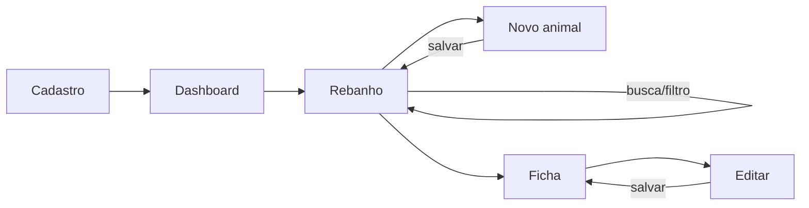

# EC01 — Cadastro e Gestão do Rebanho

## Objetivo
Demonstrar que um produtor rural consegue criar a conta, visualizar o rebanho e
cadastrar, localizar e editar animais sem planilhas ou cadernos.

## Cenário
Produtor de gado de corte e leite (persona fictícia: **Fazenda Esperança, Rio Claro/SP**)
controla o rebanho em caderno. Ao comprar uma novilha, precisa registrá-la e depois
encontrar rapidamente qualquer animal pelo brinco ou nome.

## Pré-condições
- App instalado e com internet no primeiro acesso.
- Nenhuma conta criada para o e-mail usado.

## Fluxo

| Passo | Tela | Ação do usuário | Resposta do sistema |
|---|---|---|---|
| 1 | Cadastro | Escolhe **Produtor Rural**, informa nome, e-mail e senha (mín. 8) | Cria a conta no Firebase Auth e o perfil `users/{uid}` com `role = producer` |
| 2 | Dashboard | — | Exibe saudação, KPIs e módulos. No primeiro acesso, cria um rebanho demonstrativo com 7 animais (uma única vez) |
| 3 | Rebanho | Abre a aba Rebanho | Lista animais ativos com raça, sexo, idade, peso e badge de status |
| 4 | Novo animal | Toca **+**, preenche brinco `101`, nome `Jabuticaba`, raça Girolando, fêmea, nascimento, peso `285` | Valida brinco e data obrigatórios, peso numérico; salva em `users/{uid}/animals` |
| 5 | Rebanho | Digita `jabu` na busca | Filtra em memória (sem nova consulta) por brinco, nome, raça ou RFID |
| 6 | Rebanho | Seleciona o chip **Fêmeas** | Mostra apenas fêmeas ativas |
| 7 | Ficha do animal | Toca no animal → ícone de editar → altera peso | Atualiza o mesmo documento (mesmo id), preservando status e prenhez |



## Regras de negócio aplicadas
- Senha com no mínimo 8 caracteres no cadastro; e-mail validado por formato.
- Papel (`producer`/`vet`) escolhido no cadastro e **imutável** depois.
- Rebanho demonstrativo semeado **uma vez por produtor** (marca `demoSeededAt`).
- Busca e filtros aplicados em memória: a lista é carregada uma vez do Firestore.
- Editar não altera a situação de baixa (vendido/óbito) do animal.
- A tag RFID é lida pelo brete (EC09): via MQTT com o ESP32 ou, sem hardware, em modo simulação.

## Critérios de sucesso
- [ ] Conta criada e redirecionada ao dashboard.
- [ ] Animal novo aparece na lista e na busca.
- [ ] Edição reflete imediatamente na ficha e na lista.
- [ ] Dados persistem após fechar e reabrir o app (inclusive offline).

## Evidências (capturas reais)
1. Tela de cadastro com o papel Produtor selecionado.
2. Dashboard após o primeiro login.
3. Formulário de novo animal preenchido.
4. Lista filtrada pela busca `jabu`.
5. Ficha do animal após a edição.

## Limitações observadas
- Sem o hardware do brete, a leitura RFID é simulada.
- No primeiro login com Google o usuário escolhe o papel (produtor ou veterinário); depois ele não pode ser alterado.
- "Esqueci minha senha", na tela de login, envia o link de redefinição por e-mail.

## Imagens — prompts para IA
**Abertura do estudo de caso:**
```
A Brazilian cattle farmer in a straw hat standing in a corral at golden hour, holding a
smartphone, a few Nelore and Girolando cows behind a wooden fence, an old paper notebook
sticking out of the back pocket.
```
**Antes × depois (opcional):**
```
Split composition: left side a messy paper notebook with handwritten cattle records on a
wooden table; right side the same table with a smartphone showing an abstract list of
cards with cow icons, organized and clean.
```
