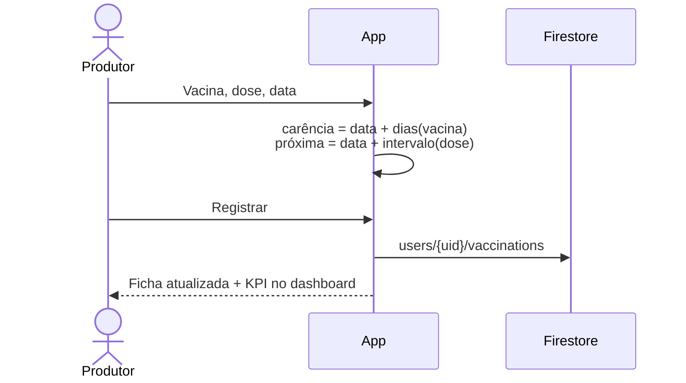

# EC02 — Manejo Sanitário e Carência

## Objetivo
Demonstrar o registro de vacinação com cálculo automático do período de carência e da
próxima dose, e o alerta de vacinas próximas no dashboard.

## Cenário
Na campanha de vacinação, o produtor aplica Febre Aftosa (1ª dose) em uma novilha.
Ele precisa saber até quando o animal não pode ir para abate nem ter o leite vendido,
e quando aplicar o reforço.

## Pré-condições
- Produtor logado (EC01) com ao menos um animal ativo.

## Fluxo

| Passo | Tela | Ação do usuário | Resposta do sistema |
|---|---|---|---|
| 1 | Ficha do animal | Toca **Vacinação** em "Registrar manejo" | Abre o formulário com o cartão do animal |
| 2 | Vacinação | Escolhe **Febre Aftosa**, dose **1ª dose**, data 10/03/2026, lote `22B-2026`, veterinário da lista | O cartão "Cálculo automático" mostra próxima dose e fim da carência em tempo real |
| 3 | Vacinação | Toca **Registrar vacinação** | Salva em `users/{uid}/vaccinations` e volta à ficha |
| 4 | Ficha → aba Sanitário | — | Mostra a vacina com "Carência até" e "Próxima dose" |
| 5 | Dashboard | — | KPI "Vacinações — próximos 30 dias" conta a dose agendada; a atividade aparece em "Atividade recente" |



## Regras de negócio aplicadas

**Carência por vacina** (catálogo do app, baseado nas orientações do MAPA):

| Vacina | Carência |
|---|---|
| Febre Aftosa | 21 dias |
| Brucelose | 0 |
| Raiva | 0 |
| IBR / BVD | 21 dias |
| Carbúnculo | 21 dias |
| Outra | 30 dias |

**Próxima dose:**

| Dose aplicada | Próxima dose |
|---|---|
| 1ª dose | +30 dias |
| 2ª dose, Dose única, Reforço anual | +365 dias |

> Antes da banca, confirme os prazos com a bula/legislação vigente e cite a fonte no TCC.

## Exemplo numérico
- Aplicação: **10/03/2026**, Febre Aftosa, 1ª dose.
- Fim da carência: 10/03 + 21 dias = **31/03/2026**.
- Próxima dose: 10/03 + 30 dias = **09/04/2026**.
- No dashboard, entre 10/03 e 09/03+30, a dose entra no KPI de "próximos 30 dias".

## Critérios de sucesso
- [ ] Datas calculadas batem com o exemplo.
- [ ] Registro aparece na aba Sanitário e no Histórico.
- [ ] KPI de vacinações e "Atividade recente" refletem o registro.
- [ ] Relatório sanitário (EC07) lista a vacinação no período.

## Evidências (capturas reais)
1. Formulário com o cartão "Cálculo automático" visível.
2. Aba Sanitário com a vacina, carência e próxima dose.
3. Dashboard com o KPI de vacinações.

## Limitações observadas
- Vermifugação e medicação são registradas na mesma ficha, com a carência informada pela bula, e entram no relatório sanitário.
- Os alertas (próximas doses, doses atrasadas e carência) aparecem no dashboard e na central de alertas, com antecedência configurável em Perfil › Configurar alertas. Não há notificação push.

## Imagens — prompts para IA
```
A rural veterinarian vaccinating a Nelore heifer in a cattle chute (brete) on a Brazilian
farm, farmer beside holding a smartphone, vaccine vials in a small cooler, sunny morning.
```
```
Conceptual illustration of a calendar with three highlighted days connected by arrows:
a syringe icon, a "pause" shield icon for withdrawal period, and a repeat-dose icon.
```
