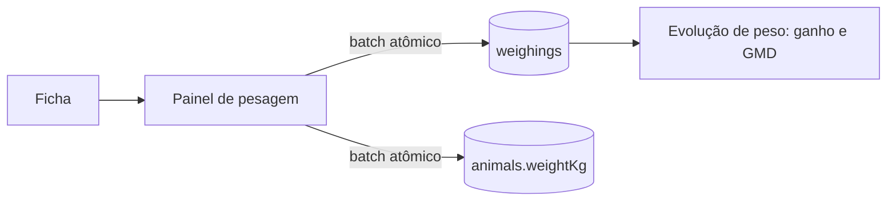

# EC03 — Controle de Peso e Ganho Médio Diário (GMD)

## Objetivo
Demonstrar o registro de pesagens e o cálculo automático do ganho de peso e do GMD,
indicador central da pecuária de corte.

## Cenário
O produtor pesa os bezerros a cada 30 dias para avaliar a pastagem e decidir o momento
de venda. Antes, o cálculo era feito à mão em planilha.

## Pré-condições
- Produtor logado com um animal ativo.

## Fluxo

| Passo | Tela | Ação do usuário | Resposta do sistema |
|---|---|---|---|
| 1 | Ficha do animal | Toca **Pesar** | Abre o painel com o peso atual |
| 2 | Pesagem | Informa `350` kg, data 01/03/2026 | Valida peso entre 0 e 1.500 kg; aceita vírgula decimal |
| 3 | Pesagem | Salva | Grava a pesagem **e** atualiza o peso atual do animal no mesmo batch atômico |
| 4 | Pesagem | Repete com `395` kg em 30/04/2026 | — |
| 5 | Ficha → Resumo | — | Seção "Evolução de peso" mostra Atual, Ganho total e GMD, e as 5 últimas pesagens |



## Regras de negócio aplicadas
- **Ganho total** = peso da pesagem mais recente − peso da mais antiga.
- **GMD** = ganho total ÷ dias entre a primeira e a última pesagem.
- GMD só é exibido com 2 ou mais pesagens e período maior que zero.
- Pesagem e peso atual são gravados juntos: ou ambos, ou nenhum.

## Exemplo numérico

| Data | Peso |
|---|---|
| 01/03/2026 | 350 kg |
| 30/04/2026 | 395 kg |

- Período: **60 dias**.
- Ganho total: 395 − 350 = **45 kg**.
- GMD: 45 ÷ 60 = **0,75 kg/dia**.

## Critérios de sucesso
- [ ] Valores exibidos batem com o exemplo.
- [ ] Peso atual do animal muda para 395 kg na lista do rebanho.
- [ ] Relatório financeiro (EC07) mostra o GMD do animal.
- [ ] Peso inválido (0 ou acima de 1.500) é recusado com mensagem.

## Evidências (capturas reais)
1. Painel de pesagem preenchido.
2. Seção "Evolução de peso" com ganho e GMD.
3. Lista do rebanho com o peso atualizado.

## Limitações observadas
- A ficha mostra o gráfico de evolução de peso a partir da 2ª pesagem.
- Pesagem é manual (a balança do brete ainda não está integrada).

## Imagens — prompts para IA
```
Young Nelore steers walking onto a livestock scale platform on a Brazilian farm, a farmer
reading a smartphone beside the scale, green pasture in the background.
```
```
Simple infographic illustration of a calf growing into a steer along a timeline arrow,
with an upward green line chart behind them, no numbers.
```
