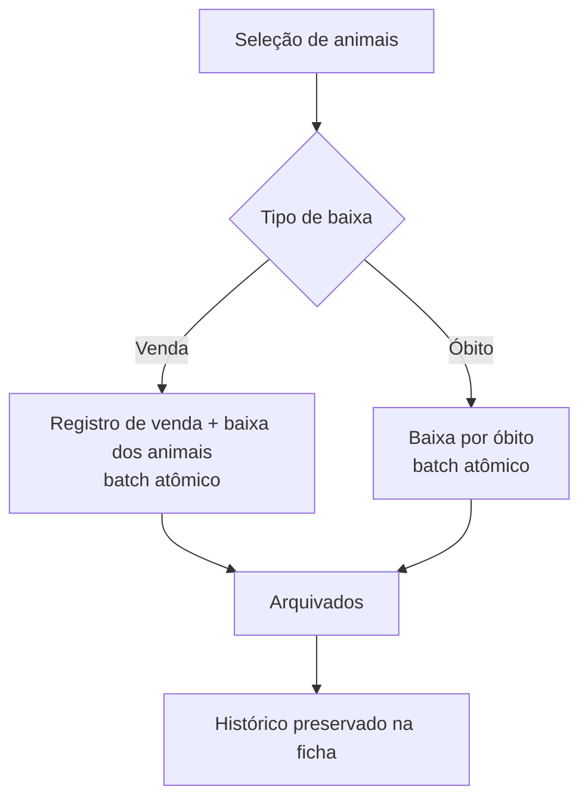

# EC04 — Baixa do Rebanho: Venda em Lote e Óbito

## Objetivo
Demonstrar a saída de animais do rebanho ativo (venda individual ou em lote e óbito),
com preservação do histórico e cálculo de valores por cabeça e por arroba.

## Cenário
O produtor vende três novilhos a um frigorífico e, na mesma semana, perde uma vaca por
causa sanitária. Ele precisa tirar esses animais do efetivo sem apagar o histórico.

## Pré-condições
- Produtor logado com pelo menos 4 animais ativos.

## Fluxo — venda em lote

| Passo | Tela | Ação do usuário | Resposta do sistema |
|---|---|---|---|
| 1 | Rebanho | Pressiona e segura um animal | Entra em modo seleção |
| 2 | Rebanho | Toca em mais dois animais | Título mostra "3 selecionados"; botão "Dar baixa (3)" |
| 3 | Dar baixa | Escolhe **Venda**, comprador, valor R$ 24.000, peso total 1.200 kg | Sugere o peso somado dos animais; mostra a média por cabeça |
| 4 | Dar baixa | Confirma | Grava a venda e marca os 3 animais como vendidos num **único batch atômico** |
| 5 | Arquivados | Abre pelo ícone de arquivo | Lista os vendidos com data |

## Fluxo — óbito

| Passo | Tela | Ação do usuário | Resposta do sistema |
|---|---|---|---|
| 1 | Ficha do animal | Toca **Dar baixa do rebanho** | Abre o painel |
| 2 | Dar baixa | Escolhe **Óbito**, causa e data | — |
| 3 | Dar baixa | Confirma | Animal marcado como óbito; ficha mostra o banner de arquivado |



## Regras de negócio aplicadas
- A baixa **arquiva**, não apaga: vacinas e pesagens continuam na ficha.
- Venda exige pelo menos 1 animal, sem duplicatas, valor não negativo.
- Uma venda com mais de um animal é registrada como "lote".
- Arroba = 15 kg. R$/@ = valor total ÷ (peso total ÷ 15).
- Animais arquivados saem dos KPIs do dashboard e dos relatórios de rebanho ativo.

## Exemplo numérico
- 3 animais, peso total 1.200 kg = **80 @**.
- Valor total R$ 24.000.
- R$ por cabeça: 24.000 ÷ 3 = **R$ 8.000**.
- R$ por arroba: 24.000 ÷ 80 = **R$ 300/@**.

## Critérios de sucesso
- [ ] Os 3 animais somem do rebanho ativo e aparecem em Arquivados.
- [ ] Efetivo total do dashboard cai em 4 após venda e óbito.
- [ ] Relatório de vendas (EC07) mostra R$ 8.000/cab. e R$ 300/@.
- [ ] Ficha do animal vendido mantém vacinas e pesagens.

## Evidências (capturas reais)
1. Rebanho em modo seleção com 3 animais.
2. Painel de venda preenchido.
3. Tela Arquivados.
4. Ficha com o banner de óbito.

## Limitações observadas
- Não há desfazer baixa pela interface.
- Comprador é texto livre (sem cadastro de compradores).

## Imagens — prompts para IA
```
Three Nelore steers being loaded onto a livestock truck at a Brazilian farm loading ramp,
the farmer and a buyer shaking hands nearby, late afternoon light.
```
```
Conceptual illustration of an archive box with cow-shaped cards being filed into it,
symbolizing preserved history, calm and respectful tone.
```
