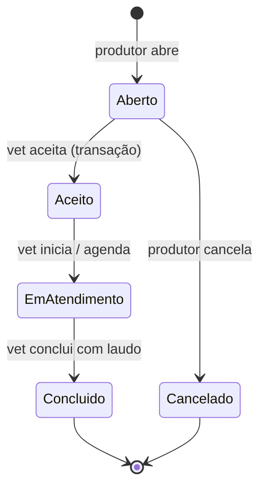

# EC05 — Chamado de Atendimento Veterinário

## Objetivo
Demonstrar a conexão entre produtor e veterinário: abertura do chamado, aceite pelo
veterinário, agendamento, atendimento e conclusão com laudo.

## Cenário
Uma vaca apresenta dificuldade no parto à noite. O produtor abre um chamado urgente pelo
app. Uma veterinária da região vê o chamado no pool, aceita, agenda a visita e, após o
atendimento, registra o laudo.

## Pré-condições
- Duas contas: uma de **produtor** e uma de **veterinário** (cadastro por e-mail com
  o papel Veterinário). Use dois emuladores ou faça logout entre os passos.

## Fluxo

| Passo | Perfil | Tela | Ação | Resposta do sistema |
|---|---|---|---|---|
| 1 | Produtor | Dashboard → Meus chamados | Toca **Novo chamado** | Abre o formulário |
| 2 | Produtor | Solicitar atendimento | Motivo, descrição, cidade, UF `SP`, brinco, urgência **Urgente** | Valida campos obrigatórios e UF com 2 letras; cria o chamado com status **Aberto** |
| 3 | Vet | Chamados → Abertos | — | O chamado aparece no pool de todos os veterinários |
| 4 | Vet | Painel de ações | Toca **Aceitar chamado** | Transação: só aceita se ainda estiver aberto (evita dois vets no mesmo chamado) |
| 5 | Vet | Painel de ações | **Agendar visita** e **Iniciar atendimento** | Status **Em atendimento**; aparece na Agenda |
| 6 | Vet | Painel de ações | Escreve o laudo e toca **Concluir** | Status **Concluído**; laudo obrigatório |
| 7 | Produtor | Meus chamados | — | Vê o veterinário, a data agendada e o laudo |



## Regras de negócio aplicadas (validadas também nas Security Rules)
- Produtor cria apenas chamados próprios, sempre abertos e sem veterinário.
- Produtor só cancela enquanto o chamado está aberto.
- Qualquer veterinário lê o pool de abertos; após o aceite, só o vet atribuído e o
  produtor dono leem o chamado.
- Vet atribuído não altera dados do produtor nem transfere o chamado.
- Concluir exige laudo; chamado concluído ou cancelado é imutável.
- Nenhum chamado pode ser excluído (histórico/auditoria).

## Critérios de sucesso
- [ ] Chamado aparece no pool do vet logo após a abertura, sem atualizar a tela.
- [ ] Um segundo vet não consegue aceitar o mesmo chamado.
- [ ] Concluir sem laudo é recusado.
- [ ] Produtor vê o laudo final.
- [ ] Produtor de outra conta não vê o chamado.

## Evidências (capturas reais)
1. Formulário de abertura preenchido.
2. Pool de chamados abertos (visão do vet).
3. Painel de ações após o aceite.
4. Agenda do vet com a visita.
5. Lista do produtor com o laudo.

## Limitações observadas
- As listas são em tempo real: o chamado aparece no pool do vet e o status muda na tela do produtor sem atualizar manualmente.
- O produtor pode anexar a localização da fazenda; o vet abre a rota no app de mapas.
- Não há notificação push para o veterinário.

## Imagens — prompts para IA
```
At night on a Brazilian farm, a worried farmer with a flashlight next to a cow lying in
the barn, holding a smartphone, a soft glowing notification symbol above the phone.
```
```
Next morning, a female veterinarian arriving at the farm in a pickup truck with a vet
kit, greeting the farmer at the barn door, warm sunrise light.
```
