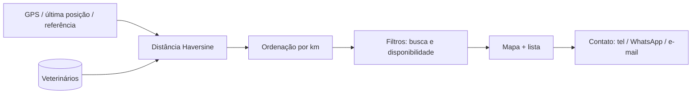

# EC06 — Localização de Veterinários

## Objetivo
Demonstrar a busca de veterinários próximos com mapa, ordenação por distância, filtro de
disponibilidade e contato direto.

## Cenário
O produtor precisa de um especialista em reprodução e quer saber quem atende na região
e está disponível agora, para ligar ou mandar WhatsApp.

## Pré-condições
- Produtor logado.
- Permissão de localização concedida. No emulador, defina a posição em
  Extended Controls → Location (ex.: Rio Claro/SP, −22,4149 / −47,5613).

## Fluxo

| Passo | Tela | Ação do usuário | Resposta do sistema |
|---|---|---|---|
| 1 | Vets | Abre a aba | Pede permissão de localização; mostra o mapa com o usuário e os veterinários |
| 2 | Vets | — | Lista ordenada por distância (km), com especialidades e CRMV |
| 3 | Vets | Digita `reprodução` | Filtra por nome, especialidade ou cidade |
| 4 | Vets | Toca o ícone de filtro | Mostra apenas veterinários disponíveis |
| 5 | Detalhe | Toca no veterinário | Especialidades, cidade, distância, raio de atendimento |
| 6 | Detalhe | **Ligar agora** / **WhatsApp** / **E-mail** | Abre o discador, o WhatsApp ou o app de e-mail |



## Regras de negócio aplicadas
- Mapa com **OpenStreetMap** (flutter_map), sem chave de API.
- Distância pela fórmula de **Haversine** (raio da Terra 6.371 km), arredondada a 0,1 km.
- Se a localização estiver negada ou desligada, o app usa Rio Claro/SP como referência
  e exibe um aviso; puxar a lista relê o GPS.
- O mapa enquadra usuário e veterinários; se o usuário estiver a mais de 300 km de
  todos, enquadra só os veterinários.

## Exemplo numérico
A partir da referência de Rio Claro (−22,4149, −47,5613), o veterinário demonstrativo
em (−22,3500, −47,5000) fica a cerca de **9,6 km** e aparece como "10 km" no cartão.

## Critérios de sucesso
- [ ] Mapa carrega os tiles (não fica cinza).
- [ ] Lista ordenada do mais próximo para o mais distante.
- [ ] Busca e filtro funcionam juntos.
- [ ] Botões de contato abrem os apps corretos.
- [ ] Com a localização negada, o aviso aparece.

## Evidências (capturas reais)
1. Tela com mapa e lista.
2. Lista filtrada por especialidade.
3. Detalhe do veterinário.
4. Aviso de localização indisponível (opcional).

## Limitações observadas
- Veterinários reais aparecem quando publicam o perfil em Perfil › Perfil profissional (CRMV, especialidades, contatos, raio e base no mapa). Os 4 perfis fictícios continuam na lista com o selo **Demonstração** — declare isso no TCC.
- A disponibilidade é mantida pelo próprio veterinário.
- Revogando o consentimento de localização, o app não lê o GPS e usa a região de referência.

## Imagens — prompts para IA
```
Stylized top-down map of a Brazilian rural region with farm plots, a blue location dot
for the farmer and several green pins with medical cross icons, soft topographic lines.
```
```
A farmer sitting on a fence calling on a smartphone, a speech bubble with a stethoscope
icon, rolling green pasture behind.
```
