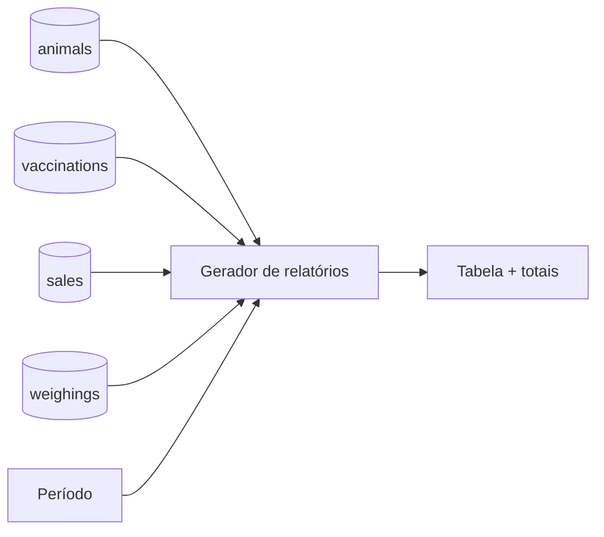

# EC07 — Relatórios Gerenciais

## Objetivo
Demonstrar a geração de relatórios consolidados a partir dos dados registrados nos
estudos anteriores, apoiando a tomada de decisão do produtor.

## Cenário
No fechamento do trimestre, o produtor precisa revisar vacinações, prenhezes, ganho de
peso, vendas e o inventário do rebanho.

## Pré-condições
- Dados gerados nos estudos EC01 a EC04.

## Fluxo

| Passo | Tela | Ação do usuário | Resposta do sistema |
|---|---|---|---|
| 1 | Relatórios | Escolhe o período **Trimestre** (ou **Livre** com datas) | Atualiza o filtro de datas |
| 2 | Relatórios | Toca em um tipo de relatório | Gera a tabela na própria tela, com total de registros e período |
| 3 | Relatórios | Repete para os 5 tipos | — |

## Tipos de relatório

| Relatório | Conteúdo | Usa dados de |
|---|---|---|
| Sanitário | Vacinas, vermifugações e medicações: produto, dose, data, carência, lote — filtrado pelo período | EC02 |
| Reprodutivo | Animais prenhes: cobertura, parto previsto (+283 dias), dias de gestação | EC01 |
| Financeiro | Brinco, raça, sexo, peso, **GMD**, status | EC03 |
| Vendas | Data, comprador, cabeças, peso, valor, R$/cab., R$/@ + linha de **TOTAL** | EC04 |
| Inventário | Rebanho ativo com idade, peso e status | EC01 |



## Exemplo esperado (com os dados do EC03 e EC04)
- Financeiro: o animal pesado mostra **0,750 kg/dia** de GMD.
- Vendas: a linha do lote mostra **R$ 8.000/cab.** e **R$ 300/@**; o TOTAL soma as
  vendas do período e calcula o R$/@ médio ponderado.

## Critérios de sucesso
- [ ] Os 5 relatórios geram sem erro.
- [ ] Mudar o período altera o relatório sanitário e o de vendas.
- [ ] Valores conferem com EC02, EC03 e EC04.
- [ ] Animais vendidos/óbito não aparecem no inventário.

## Evidências (capturas reais)
1. Tela de relatórios com o período selecionado.
2. Relatório de vendas com a linha TOTAL.
3. Relatório financeiro com GMD.

## Limitações observadas
- Exportação em **PDF** (A4 paisagem) e **CSV** (separador `;`, abre no Excel pt-BR) pela folha de compartilhamento do celular.
- Reprodutivo e inventário refletem a situação atual, não o período.

## Imagens — prompts para IA
```
A farmer at a wooden kitchen table in a farmhouse reviewing a tablet showing abstract
bar charts and tables, a coffee cup and a cowboy hat on the table, morning window light.
```
