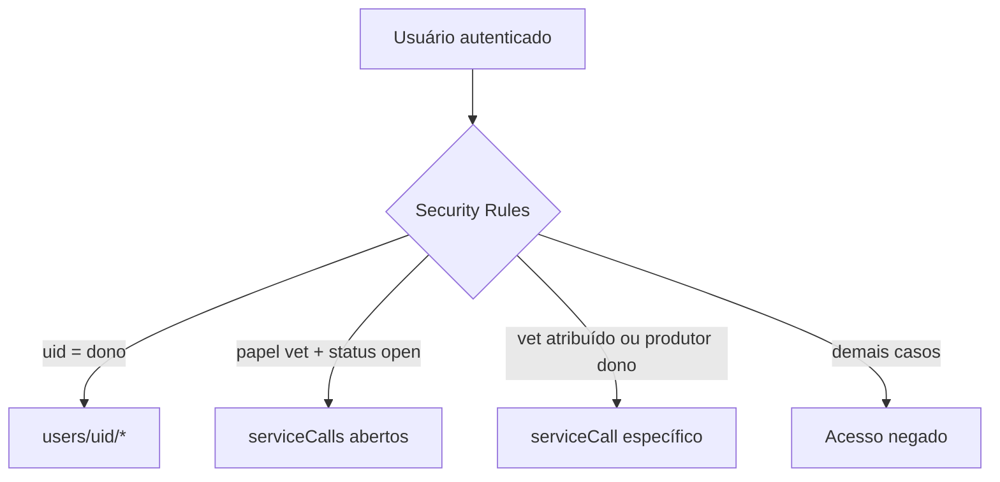

# EC08 — Segurança, Papéis e LGPD

## Objetivo
Demonstrar que os dados de cada usuário ficam isolados, que os papéis de produtor e
veterinário são respeitados e que o titular pode excluir a conta e os dados (LGPD).

## Cenário
Dois produtores vizinhos e uma veterinária usam o app. Cada produtor só pode ver o
próprio rebanho; a veterinária só vê chamados do pool ou atribuídos a ela. Um produtor
decide deixar de usar o app e pede a exclusão dos dados.

## Pré-condições
- Contas: Produtor A, Produtor B, Veterinária.
- Regras publicadas (`firebase deploy --only firestore:rules`).

## Fluxo

| Passo | Perfil | Ação | Resultado esperado |
|---|---|---|---|
| 1 | Produtor A | Cadastra animais e abre um chamado | Dados gravados em `users/{uidA}` |
| 2 | Produtor B | Abre o rebanho e "Meus chamados" | Não vê nada do Produtor A |
| 3 | Veterinária | Tenta abrir uma rota do produtor (ex.: `/herd`) | É redirecionada ao dashboard (guarda por papel) |
| 4 | Veterinária | Abre Chamados | Vê o pool; após aceitar, o chamado sai do pool dos outros vets |
| 5 | Produtor B | Perfil → Excluir conta (logo após o login) | Apaga animais, vacinações, vendas, pesagens, perfil e conta |
| 6 | Produtor B | Excluir conta com sessão antiga | App pede novo login antes de apagar qualquer dado |



## Controles aplicados
- Autenticação Firebase (e-mail/senha e Google).
- Dados privados em `users/{uid}/...`, acessíveis apenas pelo dono.
- Papel imutável após o cadastro (impede autopromoção a veterinário).
- Validação de schema nas regras: campos permitidos, tipos, tamanhos e enums.
- Transições de status dos chamados controladas pelas regras.
- Guarda de rotas por papel no app.
- IDs aleatórios seguros (não previsíveis).
- Exclusão de conta completa, com verificação de login recente antes de apagar.
- Android: backup desativado para dados do app.

## Evidência automatizada
O repositório tem **61 testes automatizados das regras** (`firestore-tests/`), executados
no emulador do Firestore. Inclua a saída do `npm test` como evidência no TCC.

## Critérios de sucesso
- [ ] Produtor B não acessa dados do Produtor A.
- [ ] Veterinária não abre telas do produtor.
- [ ] Exclusão remove todas as subcoleções do usuário.
- [ ] Testes das regras passam.

## Evidências
1. Captura do rebanho vazio do Produtor B.
2. Captura do pool de chamados da veterinária.
3. Firebase Console antes e depois da exclusão (coleção `users`).
4. Saída do terminal dos testes das regras.

## Limitações observadas
- Perfil › Meus consentimentos permite revogar o uso da localização (decisão registrada com data). Perfil › Exportar meus dados gera um JSON com tudo o que o app guarda do usuário (art. 18, V).
- Chamados são preservados após a exclusão da conta, por auditoria. Justifique no TCC
  com base no art. 16 da LGPD (guarda para cumprimento de obrigação ou estudo) ou
  anonimize-os.
- Firebase App Check e restrição das chaves de API ainda dependem de configuração no
  console.

## Imagens — prompts para IA
```
Conceptual illustration of two farmhouses, each with its own padlocked green shield over
a small herd, and a veterinarian figure holding a key that only opens a shared mailbox
between them.
```
```
A smartphone with a shield and a trash-bin icon releasing small data cubes that dissolve
into light, symbolizing the right to deletion, minimal style.
```
