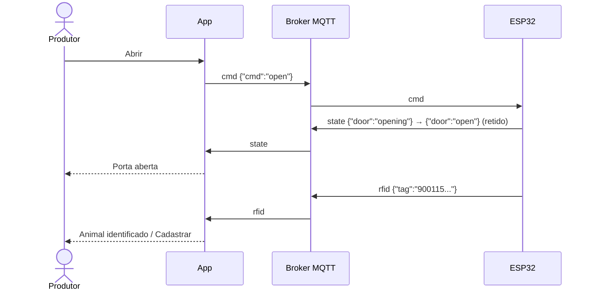

# EC09 — Brete Eletrônico e Leitura RFID

## Objetivo
Demonstrar o controle do brete (porteira, emergência, sensores) e a
identificação automática do animal pela tag RFID, com cadastro direto quando a
tag ainda não existe no rebanho.

## Cenário
No manejo da manhã, o produtor passa os animais pelo brete. Cada animal é
identificado pela tag eletrônica; um bezerro recém-comprado tem tag mas ainda
não foi cadastrado.

## Pré-condições
- Produtor logado com animais que tenham RFID (cadastrados lendo a tag).
- **Com hardware:** ESP32 e broker MQTT configurados no `.env`
  (`docs/BRETE_MQTT_PROTOCOLO.md`). **Sem hardware:** o painel abre em
  **modo simulação** — declare isso no TCC.

## Fluxo

| Passo | Tela | Ação do usuário | Resposta do sistema |
|---|---|---|---|
| 1 | Brete | Abre a aba | Conecta ao brete; selo "Conectado" (ou "Simulação"); porteira fechada |
| 2 | Brete | Toca **Abrir** | Comando `open`; porteira passa por "Em movimento" e fica "Porta aberta" |
| 3 | Brete | Toca **Ler tag** | Leitura RFID; se a tag pertence ao rebanho, mostra o animal e **Ver ficha** |
| 4 | Brete | Lê uma tag desconhecida | Mostra "Tag não cadastrada" e **Cadastrar**, que abre o formulário com o RFID preenchido |
| 5 | Brete | Toca **Parada de emergência** e confirma | Porteira travada; Abrir/Fechar bloqueados |
| 6 | Brete | Toca **Rearmar brete** | Sai da emergência e fecha a porteira |



## Regras aplicadas
- O estado mostrado vem do dispositivo; o app só envia comandos.
- A porteira não fecha com o sensor infravermelho obstruído.
- Emergência trava todos os comandos até o rearme; ambos pedem confirmação.
- A tag é associada ao animal com o mesmo RFID no rebanho ativo.

## Critérios de sucesso
- [ ] Abrir/fechar refletem o estado em até 2 s.
- [ ] Emergência bloqueia Abrir/Fechar até o rearme.
- [ ] Tag conhecida abre a ficha do animal correto.
- [ ] Tag desconhecida abre o cadastro com o RFID preenchido.

## Evidências (capturas reais)
1. Painel com porta fechada e selo de conexão.
2. Porta aberta.
3. Animal identificado pelo RFID.
4. Estado de emergência.
5. Formulário de cadastro com o RFID preenchido.

## Limitações observadas
- Sem o ESP32, a validação é feita em modo simulação (mesmas regras do firmware).
- A pesagem automática pela balança do brete não faz parte do protocolo atual.

## Imagens — prompts para IA
```
A modern cattle chute (squeeze chute) on a Brazilian farm with a small electronic box
mounted on the side, an antenna for RFID, a Nelore cow inside, the farmer holding a
smartphone showing an abstract control panel, morning light.
```
```
Conceptual diagram-style illustration: a cow ear tag emitting radio waves to a
reader, connected by a dotted line to a Wi-Fi router and a smartphone, flat style.
```
